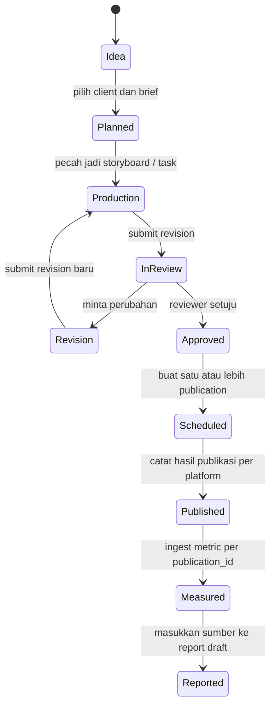
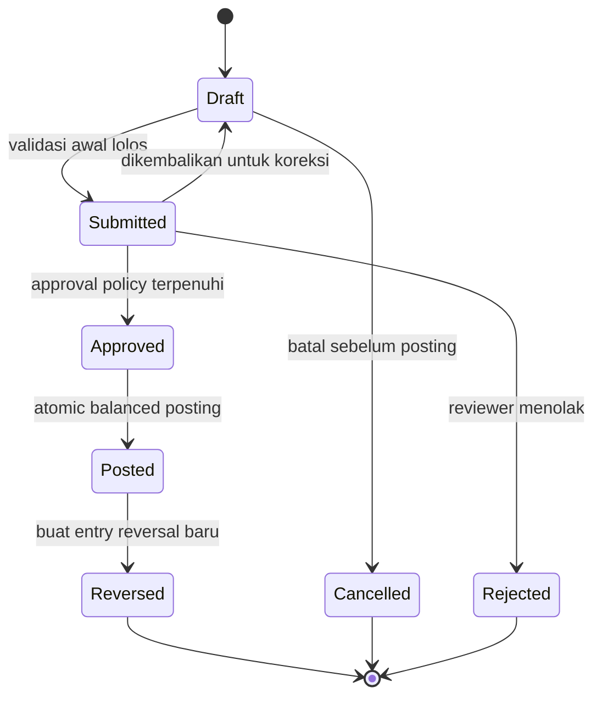
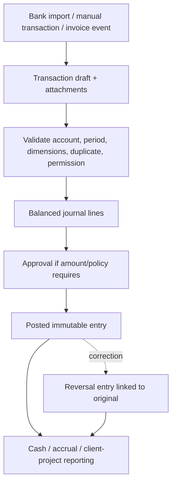

# Data flow dan lifecycle

Dokumen ini menetapkan hubungan kanonik antardata dan alur mutasi. Ini target rancangan, bukan klaim seluruh flow telah diterapkan.

## Identitas dan sumber kebenaran

| Entity | Owner | Aturan |
|---|---|---|
| `client_id` | Client Portfolio | UUID stabil; child records mengacu pada client yang sama. Client snapshot hanya untuk dokumen historis. |
| `content_id` | Content Studio | Satu ID sepanjang ide → produksi → review → jadwal → publikasi. Jangan buat konten salinan untuk tiap kanal. |
| `publication_id` | Publishing Schedule | Satu record untuk setiap platform/post window; satu content boleh memiliki banyak publikasi. Metric spesifik post merujuk publication ID. |
| `report_version_id` | Reports & Recap | Final report immutable, menyimpan rentang data/source version dan siapa/kapan finalize. |
| `journal_entry_id` | Studio Finance | Satu event accounting yang diposting dalam jurnal seimbang; transaksi bank/import adalah sumber, bukan ledger kedua. |
| `document_id` | Document Archive | Metadata file, version, source references, render status, upload status, storage pointer dan checksum. |

## Content lifecycle

Peralihan state divalidasi di server/database. Approval menunjuk revisi yang ditinjau; bila konten berubah setelah approval, revision baru memerlukan review sesuai policy. Publikasi aktual dan metrik tidak menulis ulang brief atau content ID.

## Alur request data

1. Browser meminta page/action dengan session cookie.
2. Server memverifikasi sesi via Supabase Auth dan mengambil membership aktif.
3. Application service memeriksa permission untuk command/query, memvalidasi input, lalu memakai user-scoped Supabase client.
4. PostgreSQL constraints/RLS/RPC menjadi batas integritas dan otorisasi kedua.
5. Respons mengembalikan DTO yang dibutuhkan UI tanpa secret/token dan tanpa kolom sensitif tak terpakai.
6. Job panjang disimpan sebagai job record dengan idempotency key, bukan ditahan selama request browser.

## Data isolation antar-client

- Setiap child insert/update memeriksa client ID parent dan membership scope yang diizinkan dalam transaksi/RPC.
- Composite constraints/FK (atau trigger/RPC yang aman) memastikan content, schedule, asset, report, dan finance allocation tidak dapat mengikat ID parent yang berbeda secara tidak sengaja.
- Query list selalu menyertakan filter scope dan pagination server-side. Data client bukan disaring hanya di browser.
- Snapshot dokumen menyimpan isi historis yang memang perlu dipertahankan. Snapshot tidak boleh dipakai sebagai master client yang dapat diedit.
- Tes integrasi perlu mencakup permintaan silang client: user yang berwenang pada satu scope tidak dapat membaca/mengubah ID lain melalui route, action, API, RPC, export, atau file download.

## Alur finance

Perubahan status final dan pencatatan journal/audit dilakukan atomik. `Posted` tidak dapat kembali menjadi `Draft`; correction menghasilkan chain reversal dan replacement yang dapat ditelusuri.

Journal entry dan seluruh lines diposting dalam satu transaksi database. Posting menolak debit/credit mismatch, closed period, akun non-postable, duplikasi idempotency key, dan client/project mismatch. Koreksi atas posted entry dibuat melalui reversal dan entry pengganti; record lama tidak dihapus atau diedit.

## Cash vs accrual

- **Cash basis:** laporan mengambil posting pada akun kas/bank dan mengklasifikasi arus berdasarkan akun lawan/aturan report. Transfer antar akun kas dikeluarkan dari income/expense, tetapi tetap memengaruhi saldo akun.
- **Accrual basis:** laporan memakai pengakuan pendapatan/beban pada tanggal jurnal accrual, bukan tanggal settlement. Penerimaan/pembayaran hanya menyelesaikan receivable/payable dan tidak mengakui pendapatan/beban kedua kali.
- Finance report menyimpan `basis`, `period_start/end`, currency, cutoff/posted-through time, account filters, allocation method, dan source snapshot ID.
- Project/client profitability menghitung alokasi satu kali: laporan agency memakai nilai ledger total; laporan proyek mengelompokkan alokasi dari total yang sama, tidak menjumlahkan base entry dan allocation copy.

## Audit trail

Audit event dibuat dalam transaksi yang sama dengan perubahan penting. Event minimal memiliki actor, action, entity type/id, timestamp server, correlation/request ID, reason, dan metadata yang tidak berisi secret atau payload sensitif. Event posting/reversal, role/access change, approval, finalization, export, dan file access perlu retensi sesuai kebijakan. Log aplikasi bukan pengganti audit ledger database.
