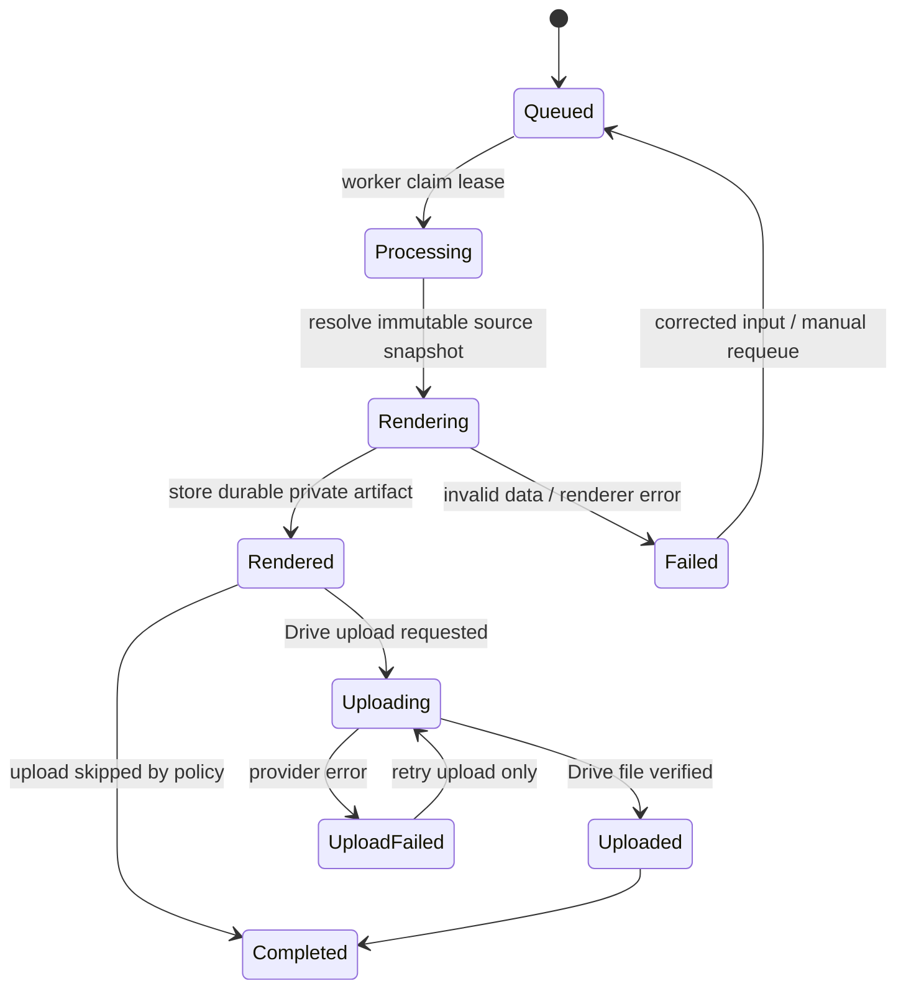

# Document generation architecture

## Jenis dokumen

- Monthly Report PDF.
- Social Media Report PDF.
- Financial report PDF/XLSX.
- Invoice PDF yang sudah ada sebagai domain dokumen terpisah.
- Uploaded/client documents dan Asset Library references.

Setiap jenis memakai fixed, versioned template. Data dinamis dimasukkan sebagai typed view model yang sudah divalidasi dan disanitasi; template tidak menjalankan query database atau menerima HTML mentah dari user.

## Status dan metadata

Gunakan satu `document_jobs` record per permintaan dengan status terpisah:

```text
job_status: queued | processing | completed | failed | cancelled
render_status: pending | rendering | rendered | failed
upload_status: pending | uploading | uploaded | failed | skipped
```

Metadata dokumen menyimpan `document_id`, `source_type`, `source_id`, `source_version_id`, `source_snapshot_hash`, `template_key`, `template_version`, `requested_by`, `requested_at`, format/locale/timezone, storage provider, object/file ID, checksum, size, timestamps, attempt count, dan error code aman.

Rendering dan upload memiliki state berbeda. Jika render sukses tetapi Drive gagal, file yang durable di private storage tetap tersedia dan job berstatus rendered + upload failed; retry upload tidak merender ulang kecuali snapshot/template berubah atau file corrupt.

## Lifecycle job



## Processing flow

```mermaid
sequenceDiagram
  participant U as User / Next.js
  participant DB as Supabase DB
  participant W as Document Worker
  participant R as Playwright Renderer
  participant S as Private Supabase Storage
  participant G as Google Drive
  U->>DB: Request export with source version + idempotency key
  DB-->>U: job_id queued
  W->>DB: Claim job with lease
  W->>DB: Load authorized immutable snapshot
  W->>R: Render fixed template and view model
  R-->>W: PDF/XLSX bytes
  W->>S: Persist durable artifact + checksum
  W->>DB: render_status=rendered, pointer recorded
  W->>G: Upload using Drive OAuth
  alt Upload succeeds
    G-->>W: drive_file_id
    W->>DB: upload_status=uploaded, job completed
  else Upload fails
    G-->>W: retryable/permanent error
    W->>DB: upload_status=failed; preserve rendered artifact
  end
  U->>DB: Poll authorized job status
```

## Queue and retry policy

- Queue row has unique idempotency key derived from requester/source version/format/template request.
- Worker atomically claims a bounded batch and stores `locked_by`, `locked_until`, `attempt_count`, `heartbeat_at`.
- Expired leases return to retryable state. Duplicate delivery is expected; handlers must be idempotent.
- Retry transient network errors, 429 and provider 5xx with exponential backoff + jitter and `Retry-After`; cap attempts and route permanent failures to failed/dead-letter state.
- Invalid source, permission denial, missing template, or revoked credential is not retried indefinitely; surface an actionable safe code.
- Separate render retry from upload retry. Upload retry uses the existing artifact pointer/checksum.
- Requeue is an authorized operation; users cannot edit status fields directly.

## Versioning and source references

Generated report binds to immutable `report_version_id`. Finance reports bind to a query cutoff/snapshot ID and filters. Invoice binds to issued invoice snapshot. A document record must include exact source IDs, template version, and hash so the rendered result is reproducible and auditable.

When source data is not finalized, either reject export or create an explicitly labeled draft export with a captured source snapshot; never imply a draft represents final data.

## Fixed templates and file safety

- Templates are code-owned HTML/CSS or workbook templates with reviewed versions.
- Escape text, disallow arbitrary remote resources/browser navigation, block untrusted URLs and cap image/data size.
- Set document locale, timezone, currency and number formatting explicitly.
- Clean temporary files and browser contexts after success, timeout, crash, or cancellation.
- XLSX export uses allowlisted sheets/columns, formula escaping for values beginning with `=`, `+`, `-`, `@`, and explicit numeric/date cell types.

## Archive and download

Archive metadata is in Supabase. Bytes are in private Storage and/or Drive. Download verifies session, active membership, finance permission if applicable, client scope, source relationship, archive status, then streams/proxies or issues short-lived access. Record export/download events for finance and sensitive client records. Do not make buckets public.

## Status user messaging

UI presents queued, rendering, ready, upload pending/failed, and permanent error separately. A ready artifact remains downloadable when Drive upload fails. User-facing messages avoid provider detail; logs retain redacted provider request IDs for support.
