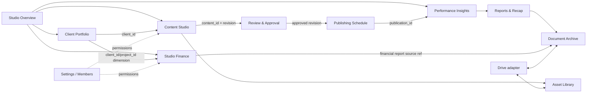

# Module boundaries

## Prinsip batas modul

- Setiap domain memiliki satu owner untuk data dan mutasi.
- Modul lain mengakses data melalui application service atau read model yang didefinisikan; tidak menulis tabel milik modul lain secara langsung.
- Foreign key lintas domain boleh dipakai untuk integritas, namun policy/ownership tetap domain-specific.
- UI boundary mengikuti modul dan role. Sidebar global tetap sama pada halaman klien; client context tampil sebagai breadcrumb/filter, bukan navigasi terpisah.
- Shared code hanya untuk aturan/integrasi yang benar-benar dipakai bersama; business rules tidak dipindah ke package generik tanpa kebutuhan.

## Batas dan kontrak

| Modul | Tanggung jawab & data owner | Service / UI boundary | Dependency | Input → output / kontrak |
|---|---|---|---|---|
| **Studio Overview** | Read model KPI agency; tidak memiliki duplikasi client/content/finance | `studio.overview.get(period, filters)`; route overview | Clients, Content, Tasks, Insights; Finance hanya ringkasan yang diotorisasi | Periode + filter → snapshot agregat dengan `as_of`, currency dan provenance |
| **Client Portfolio** | Master client, package/service, client brief, status arsip | Client service; list/detail/create/edit; semua route memakai global shell | Settings (access); Content/Finance hanya referensi client ID | Validated client command → `client_id`; semua child records merujuk ID yang sama |
| **Content Studio** | Idea, content record, brief/storyboard, revisions, production state | Content application service; Idea Bank, Planner, Production Board, Library | Client, package quota, Assets, Approval, Schedule | Create/update command → satu `content_id`; revision mencatat actor dan snapshot perubahan |
| **Review & Approval** | Review request, reviewer, decision, feedback, history | Submit/decide service; queue/detail, reviewer action | Content dan member identity | `content_id` + revision/version + reviewer → decision/history; keputusan tidak mengedit konten diam-diam |
| **Publishing Schedule** | Tiap publikasi/schedule dan platform/post reference | Schedule service; calendar/range list dan detail | Content, Client, Assets; Insights membaca publication ID | `content_id` + platform + scheduled time → `publication_id`; banyak schedule boleh menunjuk satu `content_id` |
| **Performance Insights** | Metric snapshot per publication/account/periode, import provenance | Ingest/query service; dashboard dan publication detail | Publishing Schedule, Client | `publication_id` + metric source/window → metric record; tanpa publication ID hanya metric agregat berlabel scope |
| **Reports & Recap** | Draft report, finalized version snapshot, document source refs | Report service; Monthly/Social report editors dan preview | Insights, Client, Documents | Finalize command → immutable `report_version_id`, source set, metric/window, finalizer/time |
| **Studio Finance** | Accounts, periods, transactions, journal, allocations, reconciliation, audit | Finance services/RPC; finance routes ditolak bila permission tidak ada | Members/roles, Clients/Projects, Documents, Invoice adapter | Draft/post/reverse command → journal ID dan event; hasil hanya dari posted entries sesuai basis laporan |
| **Asset Library** | Asset metadata, versions, tags, client/content links, storage reference | Asset service; browse/search/select/upload | Drive adapter, Client, Content | Upload/reference → `asset_id` dan storage state; asset tidak menyalin metadata content |
| **Document Archive** | Generated/uploaded document metadata, source refs, version, retention/status | Document service; archive/detail/download | Finance, Reports, Client, Drive/Storage | Source ref + template/version → document job; dokumen archive menyimpan pointer, bukan menyalin source payload sebagai master |
| **Studio Settings** | Agency profile, locale, preferences, integrations configuration metadata | Settings service; scoped settings screens | Member admin; Drive connection diagnostics | Admin command → validated setting revision; secret material tidak dikembalikan ke client |
| **Member Administration** | Agency membership, role, activation, invitation state, audit | Admin service dan protected settings routes | Supabase Auth, security policy | Admin action → membership event; pemilik tidak bisa menghapus/menurunkan satu-satunya owner |

## Kontrak antarmodul

- **Client ID:** Client Portfolio menerbitkan UUID `client_id`; tidak ada satu modul pun menyimpan copy client profile untuk operasi. Dokumen/invoice/report boleh menyimpan immutable client snapshot khusus untuk isi historis dokumen.
- **Content ID:** Content Studio menerbitkan satu UUID `content_id`; jadwal, approval, revisions, dan asset links mereferensikan ID ini.
- **Publication ID:** Publishing Schedule menerbitkan ID unik per jadwal/publikasi. Performance mengikat data ke `publication_id`, bukan hanya `content_id`.
- **Version ID:** Report service menerbitkan `report_version_id` setelah finalization. Render job harus menyebut versi spesifik itu.
- **Finance source ref:** finance menyimpan tipe dan ID sumber (invoice, client/project, payment import) dengan FK/polymorphic reference tervalidasi; jangan menganggap nilai sumber sebagai journal entry.
- **Document source ref:** setiap file hasil generasi mengikat `source_type`, `source_id`, `source_version_id`, template version, dan checksum.

## Interaksi modul

## Hak UI dan operasi

- Setiap nav item hanya link ke route; server page/action memvalidasi session, membership dan permission.
- Finance nav dapat disembunyikan untuk pengguna tanpa izin, tetapi backend/RLS tetap menolak request langsung.
- Form create/edit memakai input schema modul. UI tidak membuat ID relasi yang dikirim sebagai bebas tanpa cek akses terhadap parent record.
- Dashboard/cards menggunakan read model; aksi edit dilakukan di modul pemilik.
