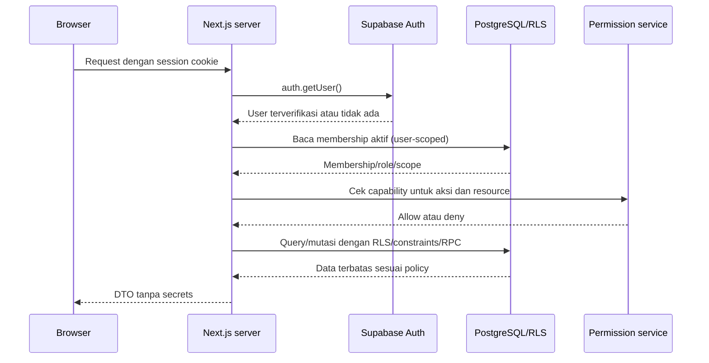

# Security architecture

## Threat model ringkas

Data yang dilindungi: identitas anggota, informasi klien, konten/draft yang belum dipublikasikan, dokumen privat, kredensial Google, invoice, payment, journal, laporan finansial, dan audit trail.

Ancaman utama: akses lintas client lewat IDOR, anggota non-finance membaca data finance, service-role exposure, OAuth token leakage, file download tanpa scope, replay/duplikasi job, mutasi ledger setelah posting, celah RLS/RPC, dan secrets/logs masuk ke repository.

## Authentication

- Supabase Auth adalah identity provider yang dituju dan sudah dipakai melalui `@supabase/ssr`.
- Gunakan `auth.getUser()` server-side untuk memvalidasi sesi, bukan mengandalkan data user yang dikirim browser.
- Cookie session diberi flags secure/httpOnly/sameSite sesuai SSR integration; route mutasi menerapkan proteksi CSRF/origin sesuai pola framework.
- Offboarding menonaktifkan membership dan mencabut sesi sesuai prosedur yang disetujui. Keanggotaan tidak ditentukan dari `user_metadata` yang bisa diubah pengguna.
- Password reset/signout sudah memiliki route; MFA/SSO dan umur sesi masih keputusan terbuka.

## Authorization: RBAC + scope

Usulan role awal:

| Role | Operasional kreatif | Admin anggota/settings | Finance |
|---|---|---|---|
| Owner | Ya | Ya, termasuk transfer ownership dengan guard | Sesuai grant eksplisit; finance admin tidak otomatis dari title owner bila pemisahan tugas diwajibkan |
| Admin | Ya | Ya sesuai policy owner | Tidak otomatis; grant finance terpisah |
| Member | Ya, sesuai requirement akses kreatif setara | Tidak | Tidak secara default |
| Finance viewer/operator/approver | Sesuai grant kreatif terpisah | Tidak | Hak sesuai capability dan segregation of duties |

Role/capability diputuskan sebelum implementasi. Membership aktif dan access scope client/project menjadi syarat untuk query. Jika semua anggota boleh melihat semua client, policy tetap memeriksa membership aktif; perubahan menjadi scope-based harus menambahkan grant/scope client.

Setiap operation memeriksa authorization di server action/API/application service dan di RLS/RPC/storage policy. Menyembunyikan menu bukan kontrol keamanan. Route proxy hanya lapisan navigasi awal, bukan satu-satunya gate.

## Supabase RLS dan database

- Enable RLS pada semua tabel di schema yang diekspos. Policies per operation dan per domain; gunakan `USING` dan `WITH CHECK` pada update.
- Finance tables memakai predicate finance capability dan active membership, bukan policy generik active member. Audit, account mapping, private attachments, dan report exports memiliki aturan sendiri.
- View yang expose data finansial memakai `security_invoker` atau boundary alternatif yang secara sadar melindungi RLS. Jangan mengandalkan view default yang dapat melewati RLS.
- `SECURITY DEFINER` hanya jika dibutuhkan untuk atomic controlled operation; function mengunci `search_path`, cek `auth.uid()`/capability, membatasi input, dan revoke default execute grants.
- Service role bypasses RLS; setiap query worker harus memvalidasi job, state, source ownership dan allowed operation secara eksplisit.
- DB constraint/RPC melindungi invariant yang tidak boleh tergantung pada urutan query frontend.

## Finance controls

- Pisahkan permission finance dari role kreatif umum.
- Terapkan amount thresholds dan dual approval untuk transaksi yang ditentukan policy.
- Posted entry/closed period immutable. Koreksi lewat reversal dengan actor/reason/links.
- Enforce debit=credit, status transition, period open, account state, currency, duplicate/idempotency dan client/project dimension di transaksi DB.
- Attachment private; permission download berdasarkan finance grant, bukan sekadar valid UUID.
- Export/print laporan finance diberi audit event dan memuat periode, basis, currency, cutoff, requester, dan watermark bila policy menghendaki.

## File, secrets, dan web security

- Service role, Google client secret, refresh token, webhook secrets, dan DB password berada di secret store runtime saja; jangan gunakan prefix `NEXT_PUBLIC_`.
- Supabase Storage dan Drive folder privat. Nama object memakai UUID/key yang tidak memuat PII; metadata menyimpan scope dan owner.
- Validasi content-type, ukuran, ekstensi dengan sniffing byte, quota, dan malware scanning untuk file upload. Jangan percaya MIME dari browser.
- Drive download melalui endpoint terotorisasi atau short-lived provider access; jangan mengirim access token ke client.
- Redact PII/financial data dari logs dan error payload. Jangan log body upload, OAuth response, account number penuh, atau bank credentials.
- Rate limit login, upload, report generation, dan integrasi; cegah SSRF saat membaca URL/logo atau provider callback.

## Audit trail

Audit event append-only untuk auth/admin changes, finance lifecycle, client scope/access, approval/finalization, document export/download, dan integrasi credential changes. Event menggunakan UTC timestamp, actor, action, object ID, reason, correlation ID; perubahan harus dicatat atomik ketika memungkinkan. Batasi siapa yang dapat membaca audit dan tetapkan retention.

## Authentication/authorization flow

## Backup dan recovery

Tetapkan RPO/RTO untuk database dan dokumen; aktifkan backup database sesuai tier Supabase dan salin file Drive berdasarkan retention/policy. Uji restore ke environment non-production berkala. Backup baru dianggap valid setelah restore database, file references, dan job consistency berhasil diverifikasi. Prosedur produksi belum diketahui dari repo.

## Referensi Supabase

- [RLS](https://supabase.com/docs/guides/database/postgres/row-level-security)
- [Storage access control](https://supabase.com/docs/guides/storage/security/access-control)
- [Supabase API security](https://supabase.com/docs/guides/api/securing-your-api)
