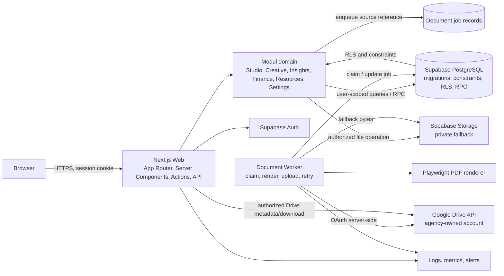

# System architecture — BABE CONTENT STUDIO

Status dokumen: rancangan target berdasarkan audit Prompt 01. Ini bukan deskripsi seluruh sistem yang sudah berjalan.

## Ringkasan keputusan

Gunakan **modular monolith** untuk aplikasi web dan domain bisnis, dengan **document worker sebagai proses terpisah**. Bentuk ini cocok dengan satu produk, satu tim dan satu PostgreSQL yang terlihat saat ini. Batas modul ditegakkan di source code, API, dan skema tanpa memperkenalkan jaringan antar-service yang belum diperlukan.

Pertahankan Next.js App Router + TypeScript, Supabase PostgreSQL/Auth/RLS, Google Drive, Playwright, dan worker Node.js sebagai arah target karena source sudah memakai sebagian besar komponen tersebut. Tailwind CSS dan Vercel belum terverifikasi dalam repository. Jangan menetapkan versi dependency sebelum manifest dan lockfile dipulihkan.

## Diagram sistem tingkat tinggi

## Komponen dan trust boundary

1. **Browser:** menampilkan UI dan memegang sesi Supabase melalui cookie SSR. Tidak memegang service role key, OAuth refresh token, Google client secret, atau akses Drive umum.
2. **Web application:** menangani route, validasi input, otorisasi, orkestrasi transaksi, dan pembacaan data sesuai anggota. Setiap mutasi sensitif melewati server-side domain service dan database policy/RPC.
3. **PostgreSQL:** sumber kebenaran data bisnis, foreign key, constraint, RLS, audit events, status workflow, snapshot, dan metadata file/job.
4. **Document worker:** proses server tepercaya terpisah; hanya worker diberi service-role key dan secret Google yang dibutuhkan. Job harus dibatasi pada tabel dan aksi yang diperlukan.
5. **Drive:** object/file store, bukan source of truth untuk business metadata. Supabase memegang `drive_file_id`, folder mapping, source, status upload, dan checksum.
6. **Supabase Storage:** private fallback untuk file yang memerlukan kesiapan download meski Drive gagal atau untuk file tertentu yang memang dikelola Supabase.

## Pola aplikasi

- `src/app` menjadi adapter tipis untuk route/page, Server Actions, dan API handlers.
- `src/modules/<domain>` memegang rules, input schemas, repository/query, dan application services milik domain.
- `src/components` berisi komponen presentasi yang reusable; tidak menjalankan query DB atau otorisasi sendiri.
- `src/lib` berisi integrasi infra bersama (Supabase client, env, logging, Drive client), bukan aturan semua domain.
- `scripts/document-worker` menjadi entrypoint/handler worker setelah struktur aktual dan package scripts dipulihkan. Untuk sekarang worker berada di `scripts/background-worker.mjs`.
- Arah monorepo `apps/` dan `packages/` ditunda. Manifest dan workspace tooling tidak ada; pemisahan proses worker dapat dilakukan tanpa memaksakan workspace package.

## Aturan data dan domain

- PostgreSQL adalah sumber kebenaran untuk status, relasi, hak akses, versi final, dan job.
- Satu record `contents.id` menjadi Content ID permanen. Schedule, revisions, approvals, metrics, dan files menyimpan foreign key eksplisit ke content/publikasi/snapshot terkait.
- Modul pemilik melakukan mutasi. Modul konsumen memakai application service atau kontrak read model; jangan membuat salinan master data.
- Server-side validation dan database constraints harus sejalan. UI hanya memberi feedback dan tidak menetapkan aturan integritas.
- Perubahan state penting memakai transaksi DB, idempotency key, dan audit event.
- Dashboard memakai query agregasi yang dibatasi periode/tenant, bukan memuat koleksi semua modul lalu menghitung di browser.

## Kondisi aktual vs rancangan

Source saat ini sudah memiliki route dan schema awal untuk clients, content, approval, tasks, performance/reports, documents/invoices, Supabase Auth, Drive, dan worker PDF/reminder. Belum ada domain finance double-entry, Asset Library, manifest package yang dapat direproduksi, generated DB types, atau bukti deployment Vercel aktif. Diagram di atas adalah target yang direkomendasikan.

## Batas deployment

Web app dapat berada di Vercel setelah compatibility/configuration diperiksa. Worker panjang yang polling antrean harus berjalan sebagai proses durable dengan restart dan batas concurrency yang diketahui; jangan menganggap fungsi request singkat sebagai worker yang selalu hidup. Pilih host worker terpisah berdasarkan kebutuhan operasi dan browser Playwright, lalu dokumentasikan sebelum tahap implementasi.
