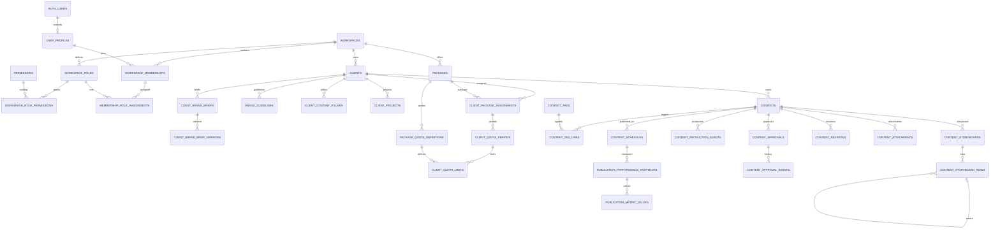
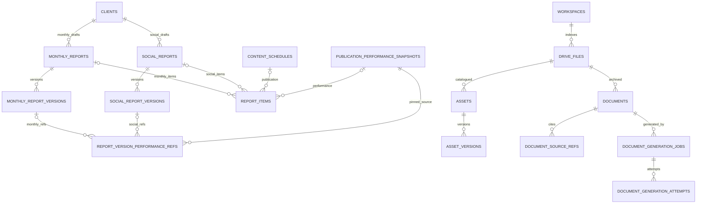

# Entity relationships

All entities below are a **proposed target**, except where called out in `database-overview.md`. They are logical entities; migration may preserve/rename existing tables instead of creating duplicates.

## ERD: workspace, client and creative spine

## ERD: reporting and resources

## ERD: finance and retained operations

```mermaid
erDiagram
  WORKSPACES ||--o{ FINANCE_PERIODS : closes
  WORKSPACES ||--o{ FINANCE_ACCOUNTS : owns
  WORKSPACES ||--o{ FINANCE_CATEGORIES : defines
  FINANCE_TRANSACTIONS ||--o{ FINANCE_JOURNAL_ENTRIES : source
  FINANCE_PERIODS ||--o{ FINANCE_JOURNAL_ENTRIES : period
  FINANCE_JOURNAL_ENTRIES ||--|{ FINANCE_JOURNAL_LINES : balances
  FINANCE_ACCOUNTS ||--o{ FINANCE_JOURNAL_LINES : account
  FINANCE_CATEGORIES ||--o{ FINANCE_JOURNAL_LINES : classifies
  FINANCE_JOURNAL_ENTRIES ||--o{ FINANCE_APPROVALS : approval
  FINANCE_ACCOUNTS ||--o{ FINANCE_RECONCILIATIONS : statement
  FINANCE_RECONCILIATIONS ||--o{ FINANCE_RECONCILIATION_ITEMS : matches
  FINANCE_JOURNAL_LINES ||--o{ FINANCE_RECONCILIATION_ITEMS : source_line
  FINANCE_JOURNAL_LINES ||--o{ FINANCE_ALLOCATIONS : attributed
  CLIENT_PROJECTS o|--o{ FINANCE_ALLOCATIONS : analytic_target
  FINANCE_TRANSACTIONS ||--o{ FINANCE_ATTACHMENTS : evidence
  FINANCE_PERIODS ||--o{ FINANCE_REPORT_SNAPSHOTS : reports
  WORKSPACES ||--o{ AUDIT_EVENTS : records
  WORKSPACES ||--o{ WORKSPACE_INTEGRATIONS : connects
  CONTENTS ||--o{ TASKS : task_context
  WORKSPACES ||--o{ TASKS : tracks
  TASKS ||--o{ TASK_ACTIVITY_LOGS : history
  TASKS ||--o{ TASK_REMINDER_EVENTS : reminders
  TASKS ||--o{ TASK_NOTIFICATION_PREFERENCES : preferences
  TASKS ||--o{ EMAIL_REMINDER_QUEUE : queued_reminder
  WORKSPACE_MEMBERSHIPS ||--o{ NOTIFICATIONS : receives
  WORKSPACE_MEMBERSHIPS ||--o{ TASK_NOTIFICATION_PREFERENCES : configures
  WORKSPACE_MEMBERSHIPS ||--o{ EMAIL_REMINDER_QUEUE : recipient
  WORKSPACES ||--o{ FINANCE_TRANSACTIONS : records
  CLIENTS o|--o{ FINANCE_TRANSACTIONS : attributed_client
  CLIENT_PROJECTS o|--o{ FINANCE_TRANSACTIONS : attributed_project
  WORKSPACES ||--o{ FINANCE_RECONCILIATIONS : reconciles
  WORKSPACES ||--o{ FINANCE_JOURNAL_ENTRIES : posts
  FINANCE_JOURNAL_ENTRIES ||--o{ FINANCE_APPROVALS : review_history
  WORKSPACES ||--o{ FINANCE_ATTACHMENTS : evidence
  FINANCE_TRANSACTIONS ||--o{ FINANCE_ATTACHMENTS : has_evidence
  FINANCE_JOURNAL_LINES ||--o{ FINANCE_ALLOCATIONS : allocated
```

## Cardinality and integrity notes

- One content record can have zero or many schedules. Schedule ID is the publication identity; performance and report references key to it, never only to content.
- Quotas count distinct content IDs in the assigned quota period. Schedules do not consume additional content quota unless a later approved rule explicitly says otherwise.
- Each report version has its own immutable snapshot. `report_items` references drafts; `report_version_performance_refs` pins the exact publication snapshot used for a finalized version.
- Storyboard rows are ordered by `(storyboard_id, position)` and may point to a parent row inside the same storyboard.
- Every cross-domain FK that includes client-owned data carries `(workspace_id, client_id, referenced_id)` or a corresponding composite unique key.
- A journal entry has at least two lines. Posting is an atomic server-side action that verifies equal debit/credit totals. Reversal is a new entry referencing its source; no posted line is edited.
- Allocation rows describe attribution of an existing journal line to a client/project and do not create another journal posting.

For field-level constraints and delete policies, see `table-specifications.md`.

The ERDs intentionally show the relationship spine rather than repeating every workspace FK as a line. All 68 proposed tables are listed in the table specification. The operations diagram includes task notification preferences and reminder queue; the resource diagram covers Drive metadata, asset versions, documents, source refs and render attempts.
