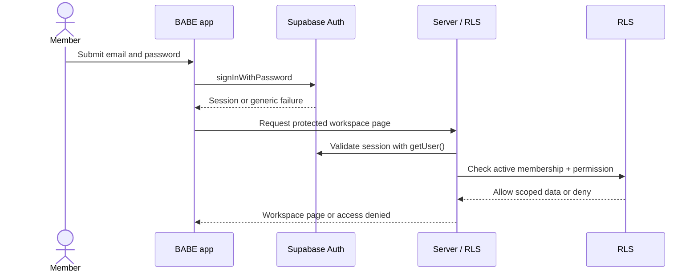

# Authentication design

## Scope and verified current state

This document describes a target for invitation-only BABE CONTENT STUDIO authentication and records repository/remote findings as of 2026-11-06. No user accounts were created, no emails were sent, and no Auth settings were changed.

Verified in source:

- Supabase Auth is the identity provider. Browser and server clients use `@supabase/ssr`; the server `getActiveWorkspaceContext()` calls `auth.getUser()` and checks `agency_members.id = auth.users.id` with `is_active=true`.
- Login uses `signInWithPassword`; logout calls `signOut`; forgot-password uses `resetPasswordForEmail`; password update calls `updateUser({ password })` only after Supabase establishes a valid session.
- The PKCE callback at `/auth/callback` exchanges the one-time code server-side and routes to password setup. Invitation callbacks use `flow=invite`; recovery callbacks use `flow=recovery`.
- No application `signUp`, administrator invitation issuance, invitation record/acceptance, invite resend/revoke or Team & Members flow is implemented. The callback UI is not a complete invitation system.
- `src/proxy.ts` checks authenticated user for a subset of paths. Workspace context also protects many pages/actions; proxy path matching alone is not a complete authorization boundary.
- There is no checked-in Auth provider configuration for disabling public sign-up. Hosted project setting for sign-up/confirmation, password policy, URL allowlist, SMTP and session lifetime was not exposed by the available read-only inspection; do not assume the remote setting.
- Identity and membership are currently joined through `agency_members` rather than a separate application `user_profiles` table. Current role constraint is `owner`, `admin`, `member`.

## Target configuration

Use Supabase Auth email/password, invitation-only provisioning, verified-email requirement, and no Google OAuth for MVP. Disable public sign-up in hosted Auth settings and local Auth config once explicitly implemented. Use exact production/staging redirect allowlists; never accept an arbitrary `redirectTo` from a request. Configure authenticated email templates and an agency-owned SMTP sender; `babeagency.id@gmail.com` is an agency contact, not a shared login.

User identity is `auth.users.id` UUID. Application `user_profiles.user_id` and `workspace_memberships.user_id` reference it. Password hashes remain entirely in Supabase Auth. Store role, membership state and audit identity in application tables, not user-editable metadata. `user_metadata` is user-editable and must never authorize. `app_metadata` may be administered server-side, but database permissions should consult current membership/permission state so a stale JWT claim cannot keep access after revocation.

## First-time activation

The user cannot create a password merely by entering an email. A workspace administrator creates a pending application invitation and then a server-only administrative operation calls Supabase Auth `inviteUserByEmail` using the service-role client. The invitation has an expiry, inviter, intended role/capability, status, and opaque provider reference; only a hashed, single-use application token is stored if a separate app token is required. The provider invitation link proves email control. Send its redirect to `/auth/callback?flow=invite`; the implemented callback exchanges the one-time code for a PKCE session and routes to “Create your password.” Application invitation records, intended workspace/role validation, invitation consumption, and membership activation still need server-side implementation before real invitations are sent. `updateUser({ password })` requires the valid session. Do not return tokens or service credentials to the browser.

For a user-requested activation/resend endpoint, respond with the same generic message regardless of whether an eligible invitation exists, apply IP/email rate limits and cooldowns, and send only to pre-registered addresses. Prefer administrator-initiated invite/resend in MVP to reduce abuse. Do not reveal invitation existence in UI, timing-sensitive errors or logs.

```mermaid
sequenceDiagram
  actor Member
  participant App as BABE app
  participant Server as Trusted server
  participant Auth as Supabase Auth
  participant DB as Membership database
  Member->>App: Open invite URL
  App->>Auth: Exchange one-time PKCE code
  Auth-->>App: Verified session and user UUID
  Member->>App: Choose password
  App->>Auth: updateUser(password) over authenticated session
  Auth-->>App: Password set
  App->>Server: Complete activation (session + invitation reference)
  Server->>DB: Validate pending, unexpired invitation and email/user match
  Server->>DB: Consume invite; activate membership; append audit event
  DB-->>App: Active workspace membership
  App-->>Member: Studio Overview
```

## Subsequent login and recovery

- Login is email + password through Supabase Auth `signInWithPassword`. Return one generic failure for invalid email/password, inactive membership, suspended/deactivated account and unknown email; do not let the interface distinguish them.
- Successful authentication is not sufficient for application access: every protected server operation and RLS policy checks active workspace membership and permission.
- Logout clears the local session. Provide a distinct “sign out all sessions” path only if the user requests it; session revocation behavior should be validated against current Supabase Auth semantics before implementation.
- Forgot password uses `resetPasswordForEmail` with `/auth/callback?flow=recovery`, the same response text for any address, rate limits and no email in logs. Password update requires a valid recovery session and should rotate/revoke other sessions per the chosen policy.
- Refresh and cookie handling continue through the SSR client and PKCE. Validate `getUser()` on server for authorization; do not trust unverified decoded client claims.
- On account suspension/deactivation, disable membership authorization immediately. Also ban/disable the Auth user and revoke sessions where supported. Because already-issued JWTs can remain valid until expiry, do not rely on token revocation alone: active membership must be checked in RLS and server-side context for each request.



## Status lifecycle

Keep account status and invitation state conceptually distinct. The requested labels are exposed in the UI as a derived status:

| Status | Meaning and allowed actions |
|---|---|
| `INVITED` | Pending invitation exists, has not expired/revoked, no active membership; resend/cancel by authorized administrator. |
| `ACTIVE` | Email verified and active membership. Login and permitted workspace actions allowed. |
| `INVITATION_EXPIRED` | Pending invite expired without acceptance; no access. Admin may resend, creating a fresh invitation and invalidating old link. |
| `SUSPENDED` | Temporarily blocked membership/Auth user; no workspace access; authorized admin may reactivate after review. |
| `DEACTIVATED` | Membership disabled and Auth account access disabled; historical records retained. Reactivation is a deliberate audited action (or fresh invitation), never automatic. |

Allowed transitions: `INVITED → ACTIVE | INVITATION_EXPIRED | DEACTIVATED`; `INVITATION_EXPIRED → INVITED | DEACTIVATED`; `ACTIVE → SUSPENDED | DEACTIVATED`; `SUSPENDED → ACTIVE | DEACTIVATED`; `DEACTIVATED → INVITED` only through a new admin-approved invitation. Invitation expiry is computed from server time and cannot be extended by resubmitting an old token. Role changes do not alter account status.

## Initial roster (proposal only)

The initial list below is an **unprovisioned proposed registry**. Do not create Supabase Auth users, membership rows or invites from this documentation.

| Name | Email | Requested role | Provisioning |
|---|---|---|---|
| Imam Gunawan | imamgunawan@guru.smk.belajar.id | `HEAD_OF_AGENCY` | Not created |
| Ananda Abiyyu Saqib | anandaabiyyusaqib1403@gmail.com | `DEVELOPER` | Not created |
| Ahmad Ziyad Radyatma | ahmadradiyatma@gmail.com | `AGENCY_MEMBER` | Not created |
| Farrizqi Ichsan Maulana | farrizqiichsanm@gmail.com | `AGENCY_MEMBER` | Not created |
| Sayyidina Rhafa Putra Hidayat | hidayatrhafa@gmail.com | `AGENCY_MEMBER` | Not created |

Assign roles through the approved mapping in `authorization-model.md`; do not equate `HEAD_OF_AGENCY` with the current database `owner` privilege without an explicit owner decision. `babeagency.id@gmail.com` is contact-only.

## Implementation prerequisites

Confirm Auth hosted settings, signup disablement, email confirmation, redirect allowlist, SMTP, templates, password strength/leaked-password protection and session behavior. Design invitation table/audit and admin-only server action only after migration ledger reconciliation. Test duplicate and concurrent invites, expired/replayed token, wrong-email callback, changed role during session, and suspended active session without sending real mail in production.

Supabase references: [Auth users and identity](https://supabase.com/docs/guides/auth/users), [Invite user by email](https://supabase.com/docs/reference/javascript/auth-admin-inviteuserbyemail), [Password-based Auth](https://supabase.com/docs/guides/auth/passwords), [Email templates](https://supabase.com/docs/guides/auth/auth-email-templates).
