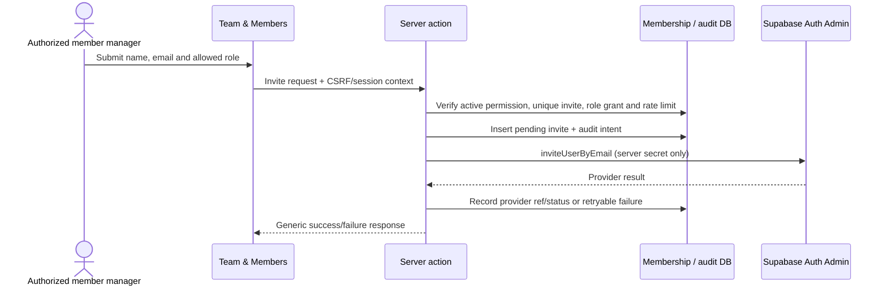
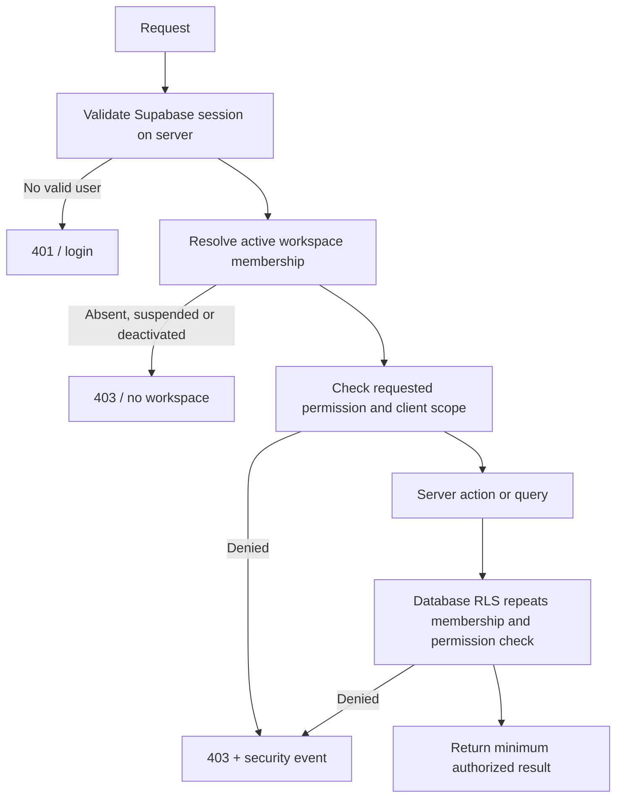

# Authorization model

## Verified current model

The current schema uses `agency_members` with `owner/admin/member`, `is_active` and `can_manage_members`; member ID is expected to equal `auth.uid()`. Migration SQL installs a role guard that prevents non-owners from assigning/removing owner status and protects the last active owner. `can_manage_agency_members()` recognizes active owner/admin. Source has no invitation or member-management screen/actions; settings actions currently save agency settings, billing profile and task notification preferences.

The proposed roles in the product brief do not map 1:1 to those current roles. Do not hardcode named people in authorization code or use display labels as permission checks.

## Target model

Separate identity, membership, role and permission:

`auth.users.id → user_profiles → workspace_memberships → membership_role_assignments → workspace_roles → workspace_role_permissions → permissions`.

RLS and server authorization check a permission key against the caller's active membership and workspace. Role is a manageable bundle; permission is the actual decision. Client scope can further narrow access where the agency explicitly needs client-level separation. Role grants and removals go through server-side validated RPC/action, append an audit event and prevent self-elevation. UI hiding is convenience only.

### Proposed role mapping (requires owner approval)

| Product role | Suggested capability bundle | Explicit non-grants |
|---|---|---|
| `HEAD_OF_AGENCY` | Studio/client/creative/report access; `members.invite`, `members.manage`, `settings.manage`, operational report access | No finance permission by title alone; cannot remove/demote final workspace owner without ownership transfer flow |
| `DEVELOPER` | Normal operational membership plus `integrations.manage`, technical diagnostics/docs access and maintenance capability where needed | Not workspace owner; no member-role changes, owner transfer, finance read/post/close or RLS bypass by title |
| `AGENCY_MEMBER` | Studio overview, client portfolio, creative workflow, reviews, publishing, performance, reports, assets and archive under ordinary workspace policy | No member administration, auth administration, workspace configuration or finance permissions by default |
| Finance capability bundles | See separate matrix in `access-control-matrix.md` | Not assigned until finance authority is approved |

Suggested permission keys: `studio.read`, `clients.read/write`, `content.read/write`, `approval.request/review`, `publishing.manage`, `performance.read/write`, `reports.read/write/finalize`, `assets.read/write`, `documents.read/write`, `members.read/invite/manage`, `settings.read/manage`, `integrations.read/manage`, plus finance-specific capabilities. Keep permission catalog scoped and stable; avoid a generic `admin=true` shortcut.

## Team & Members screen contract

Path: `Studio Settings → Team & Members`.

- Overview: name, email, effective application role, account/invitation state, invited/joined date, last active if a reliable and privacy-reviewed timestamp is available. Do not infer “last active” from unsafe session metadata.
- Invite: validate normalized email, uniqueness within workspace, approved role and inviter grant. Create pending invitation first, then call Auth admin invite from server; if provider call fails, retain a retryable/error state with no active membership. Use rate limit/cooldown and idempotency.
- Change role: server re-checks inviter permission and cannot self-elevate; prevent assignment of roles the actor cannot grant. Record old/new role, actor, target, reason and timestamp. Existing sessions must use database-current grants or a documented short refresh window.
- Deactivate/reactivate: transition status through server operation; disable membership access immediately, disable Auth user/revoke sessions where supported, retain authored content/approval history and append audit event. Never delete the identity or historical rows as a shortcut.
- Invite list: pending, accepted, expired, revoked. Resend invalidates previous link and sets a new expiry. Revoke is terminal for that invite. A resend does not activate membership.
- Last owner protection: never permit removal/deactivation/demotion of the last active owner. Owner transfer requires explicit confirmation, audited action and transactional invariant.



```mermaid
sequenceDiagram
  actor Head as Authorized member manager
  participant Server as Server action
  participant DB as Membership / audit DB
  Head->>Server: Change role for target membership
  Server->>DB: Lock actor and target; check permission, scope, self-elevation and owner invariant
  DB->>DB: Update role assignment and append before/after audit event atomically
  DB-->>Server: Result
  Server-->>Head: Updated membership
```

```mermaid
sequenceDiagram
  actor Head as Authorized member manager
  participant Server as Server action
  participant DB as Membership / audit DB
  participant Auth as Supabase Auth Admin
  Head->>Server: Deactivate member
  Server->>DB: Check authority and last-owner invariant
  Server->>DB: Mark membership suspended/deactivated; append audit event
  Server->>Auth: Ban user / revoke sessions where supported
  Auth-->>Server: Result recorded for follow-up
  Note over DB: RLS denies access immediately from current membership state
```

## Authorization request flow



Every server action, API route, worker operation and database query must enforce authorization at its own trust boundary. `proxy.ts` path matching and navigation visibility are defense-in-depth only. Do not rely solely on stale JWT `user_metadata`/role claims. Privileged Auth Admin requests use a server-only client and are never callable directly from browser code.

## Open mapping

The user-provided initial roster is not provisioned. Resolve how `HEAD_OF_AGENCY` maps to an owner-like immutable capability and whether there must be one or multiple workspace owners. Decide whether `DEVELOPER` can manage integrations only or also deploy/operate production. Keep finance grants separate pending approval.
